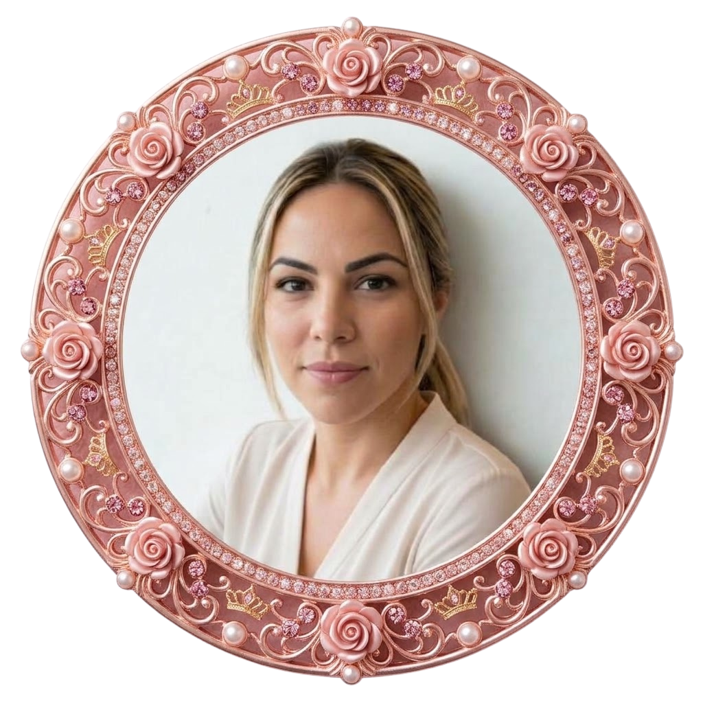

<!--
╔══════════════════════════════════════════════════════════════════╗
║  PLANTILLA DE README DE PERFIL DE GITHUB                         ║
║                                                                  ║
║  CÓMO USARLA                                                     ║
║  1. Crea un repo PÚBLICO con el mismo nombre que tu usuario.     ║
║  2. Pega este contenido en su README.md.                         ║
║  3. Busca y reemplaza (Ctrl+H) estos marcadores:                 ║
║       TU_USUARIO  → tu usuario de GitHub                         ║
║       TU_NOMBRE   → tu nombre                                    ║
║       TU_LINKEDIN → tu usuario de LinkedIn                       ║
║       TU_EMAIL    → tu correo                                    ║
║  4. Edita los textos marcados con ✏️ y borra las secciones        ║
║     marcadas como OPCIONAL que no quieras.                       ║
║  Estos comentarios <!‐‐ ‐‐> no se ven en GitHub; puedes dejarlos.║
╚══════════════════════════════════════════════════════════════════╝
-->

<!-- ═══════════════ 1. CABECERA ═══════════════ -->

<!-- OPCIONAL: tu foto. Súbela a una carpeta Images/ del repo con ese nombre,
     o borra este bloque. -->

  

<!-- Texto animado. Para cambiar frases, fuente o color, genera la URL en:
     https://readme-typing-svg.demolab.com/demo/?font=DynaPuff&color=F791CF
     Cada frase va separada por ";" y los espacios se escriben como "+". -->

  

<!-- ═══════════════ 2. CONTACTO ═══════════════ -->

<!-- Más insignias en https://shields.io/badges  (cambia el nombre, el color
     hexadecimal y el logo; los logos salen de https://simpleicons.org) -->

  
  
  <!-- OPCIONAL: portfolio -->
  

<!-- 

  
  <!-- OPCIONAL: contador de visitas -->
  <!-- 

 -->

<!-- ═══════════════ 3. SOBRE MÍ ═══════════════ -->

👨‍💻 Sobre mí
<!-- ✏️ Dos o tres líneas sobre ti -->

Hola, soy María de los Ángeles pero desde pequeña me llaman Marian, soy estudiante de 2º en Sistemas Microinformáticos y Redes a la que vez estudio Desarrollo de Aplicaciones en Tecnologias Web.

Fuí mamá muy joven y por circustancias de la vida no pude seguir con mis estudios ni retomarlos a corto plazo, catorce años despues de esto, con idas y venidas siempre buscando una mejor situación laboral y conciliación, decidí pensar en mí y empezar con una nueva etapa laboral.

Ahora tengo 34 años , experiencia y ganas muchas ganas de aprender y formarme cada día que pasa estoy más contenta de aprender para poder dedicarme a lo que realmente me apasiona que es el mundo tecnológico.

🔭 Tiempo atrás compaginaba estudios con trabajo, pero me dí cuenta que si quería realmente cambiar tenía que dedicarle todo el tiempo posible al aprendizaje y sobre todo cortar esa relación laboral que no me aporta nada.

🌱 Estoy aprendiendo muchísimo en Gestión de Redes ,Ecosistemas de Sistemas , Servidores ,Hardware... si mi yo de hace 10 años me viese no se creería a lo que he llegado y no puedo estar más orgullosa de los conocimientos adquiridos en tan poco tiempo.

<!-- ═══════════════ 4. TECNOLOGÍAS ═══════════════ -->

🧰 Tecnologías y herramientas
<!-- Cambia la lista después de "i=" separando por comas.
     Nombres disponibles: https://skillicons.dev  (ej.: python, react, spring,
     docker, nodejs, ts, php, laravel, postgres, mongodb, figma, linux...) -->

  

<!-- ═══════════════ 5. ESTADÍSTICAS ═══════════════ -->

📊 Estadísticas de GitHub
<!-- Temas disponibles: dark, radical, tokyonight, react, dracula, gruvbox,
     onedark, github_dark, transparent...
     Cambia "theme=react" en las TRES imágenes para que combinen.
     Nota: la instancia pública de github-readme-stats a veces no carga por
     límites de uso; si te pasa a menudo, se puede desplegar una propia. -->

  
  

  

<!-- ═══════════════ 6. PROYECTOS DESTACADOS (OPCIONAL) ═══════════════ -->

📌 Proyectos destacados
<!-- Cambia NOMBRE_REPO por repos tuyos. Añade o quita tarjetas. -->

  
  
  

<!-- ═══════════════ 7. OBJETIVOS ═══════════════ -->

🚀 Objetivos actuales
<!-- ✏️ -->

💡 Aprender cada día más.
🔨 Terminar los grados que estoy cursando.
💼 Conseguir trabajar en una empresa en la que realmente pueda aportar mi valor y ser reconocida .

<!-- ═══════════════ 8. CIERRE ═══════════════ -->

<!-- ✏️ Una frase que te guste, o borra la línea -->

"Las metas se consiguen con constancia y perseverancia poco a poco, a cada paso que doy estoy mas cerca de ella." – Autor

⭐ ¡Gracias por pasarte por mi perfil! ⭐

